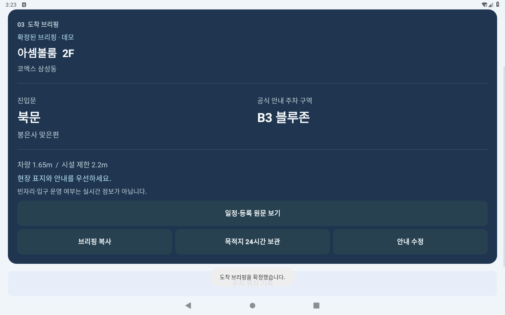

# Arrival Brief

행사 안내문에서 세부 장소를 확인하고 출발 전에 진입문·추천 주차를 준비하는 차량용 앱입니다. 사용자가 직접 적은 주차 메모를 같은 기기에서 다시 볼 수 있습니다. 초기 대상은 지원하는 코엑스 삼성동 회의실의 행사에 처음 차량으로 방문하는 운전자입니다. 전시장 Hall A/B/C/D는 현재 지원하지 않습니다.

**[처음 보는 분을 위한 검토 순서](docs/REVIEW_START.md)** · [Android APK](apk/ArrivalBrief_release.apk) · [앱 스크린샷](screenshots/rc4/README.md) · [RC3 실제 앱 연속 시연](dist/assets/media/arrival-native-journey.mp4)



RC4 실제 실행 · 확정 화면 · 2026-11-02 · 일반 Android 9 에뮬레이터에서 촬영한 release 앱입니다. 실제 Pleos·차량 촬영이 아닙니다.

현재 소스는 `1.0.0-rc4`입니다. 정식 출시·실차 적합성 인증을 뜻하지 않는 검증 후보이며, APK와 런타임 결과는 아래 검증 자료를 기준으로 구분합니다.

RC4는 주차 메모 QR의 **크게 보기·기본 크기 전환**을 추가했습니다. 같은 저장 내용과 시각을 유지하며 화면 여유가 있을 때만 확대합니다. 입력 안내도 원문의 변경·취소·진입·주차 제한을 남기도록 명확히 했습니다. 실제 Pleos 후속 확인을 위한 읽기 전용 증거 수집 도구를 추가했으며, 실제 서비스 검증 완료를 뜻하지 않습니다.

RC3에서 도입한 흐름도 유지합니다. 행사장의 층과 별도의 등록 장소, 예정된 종료 시간과 이미 종료된 안내를 구분합니다. 지원하는 일정·등록 문장은 원문을 남긴 채 검토할 수 있습니다. Android에서 확정하면 입력 영역을 접고 도착 패스를 크게 보여줍니다. 안내를 수정하면 확정과 세 가지 확인을 해제하여 다시 검토하게 합니다. [개발 사례 비교](docs/verification/award-scenarios.md), [독립 경계 검토](docs/verification/award-independent-review.md), [운영자 도입 가설과 실행 양식](docs/BUSINESS_VALIDATION.md)을 함께 제공합니다.

## 사용 흐름

같은 기기의 안내문 공유 또는 파일 가져오기 → 행사장·차량 조건 확인 → 브리핑 확정 → 실제 주차 위치 기록 → 같은 기기 재열람 또는 Android의 수동 QR 반출.

- Android는 같은 기기의 `text/plain` 공유를 받고 웹은 40KB 이하 `.txt` 파일을 가져옵니다. 가져온 원문으로 기존 확정을 자동 교체하지 않습니다. 휴대폰에서 차량으로 전송·동기화하는 기능은 아닙니다.
- 행사장 문장과 명시적인 주차 문장을 분리합니다. 별도 주차 문구가 공식 추천과 충돌하거나 모호하면 확정을 보류하며 원문의 시설·변경·취소·종료 표현을 계속 검사합니다. 보류할 때는 확인이 필요한 원문 문장도 함께 표시합니다.
- 8개 회의실 분류 중 5개는 안내하고, 공식 자료가 상충하는 컨퍼런스룸 E·300~328호·400~403호는 확정·내보내기를 보류합니다.
- Android는 사용자 요청으로 NaviHelper의 목적지 이름·주소를 읽고 코엑스 삼성동 회의시설과 대조합니다. 이는 조회 시점의 시설 확인이며 회의실·입구 좌표·경로 확인이 아닙니다. SDK 실기 응답은 아직 검증하지 못했습니다.
- 내비 시설 불일치는 확정을 막습니다. 미조회·판정 불가·서비스 오류에는 직접 시설 확인이 필요하며, 이미 확인된 불일치를 수동 체크나 실패한 재시도로 지울 수 없습니다.
- 차량 플랫폼의 입력 허용과 물리적 정차는 구분합니다. `CarUxRestrictions` 미확인·제한·연결 해제 시 입력을 잠그고, 사용자의 안전 주차 확인도 요구합니다.
- 웹에서는 차량 상태를 시뮬레이션합니다. 현재 유효한 행사장·차량 높이·안전 주차를 각각 확인해야 확정하며 실제 NaviHelper 연결이 있는 것처럼 표시하지 않습니다.
- 확정한 목적지 1건을 사용자가 명시적으로 24시간 보관·복구·삭제할 수 있습니다. 목적지 ID·시각·자료 버전만 저장하고 원문·높이·내비 주소는 저장하지 않습니다. 복구는 재확인이 필요한 초안입니다.
- 실제 주차 위치는 별도 안전 주차 확인 후 64자 이내로 직접 기록합니다. 기기 안에 1건을 24시간 보관하고 재열람·삭제합니다. 공식 추천·자동 위치 추적·실내 길찾기와 다른 정보입니다. Android는 안전 확인 후 메모를 텍스트 QR로 표시할 수 있습니다. 휴대폰 카메라로 읽고 별도 저장해야 하며 서버·URL·자동 동기화를 쓰지 않습니다. 앱의 24시간 만료·삭제 규칙은 휴대폰에 만든 복사본에는 적용되지 않습니다. 실제 휴대폰의 광학 스캔은 별도 검증이 필요합니다.
- 규칙 기반으로 처리하며 행사 안내문을 외부 AI나 서버로 보내지 않습니다. Vehicle·브레이크 진단 의존성과 관련 권한은 제거했습니다.

## 화면 구성

입력은 개방된 준비 영역, 결과는 짙은 도착 패스로 구분합니다. 차량·루프박스 높이 그림, 진입문→주차→행사장의 안내 관계도, 확인/보류 상태의 색상을 사용합니다. 관계도는 실제 지도가 아니며 확인 전에는 진입문·주차 값을 보여주지 않습니다. 주행 화면에서는 확정한 핵심 정보만 표시하고 그림과 모션을 숨깁니다.

소개 첫 화면은 오디토리움(북문·B3 블루존)과 스튜디오159(동문·B2 퍼플존) 예시를 직접 전환하고, 공식 추천과 사용자가 적은 주차 위치를 나눠 보여줍니다. [설계 근거](research/design-reference-2026-11-01.md), [독립 모의 검토 기록](docs/design-review.md), [현재 Android 앱 화면](screenshots/rc4/README.md)을 제공합니다. 캡처별 빌드와 시험 환경을 기록하며 실제 Pleos 서비스 화면으로 표시하지 않습니다. 실제 사용자 연구나 공식 심사 결과가 아닙니다.

[앱 스크린샷 모음](screenshots/README.md)은 현재 RC4와 이전 RC3·RC2를 구분합니다. 가로 1280×800의 일반 Android 9 에뮬레이터에서 확보했으며, release 실행과 debug UI 시험 화면을 구분했습니다. 이전 RC2의 원본 30장·대표 화면 8장·PDF·ZIP도 보존합니다.

## 실행

### 웹

저장소 최상위에서 Python 3으로 실행합니다.

```sh
python -m http.server 8000 --bind 127.0.0.1
```

`http://127.0.0.1:8000/`은 소개 페이지, `/dist/arrival/`은 웹 체험입니다. 별도 패키지나 API 키가 필요 없습니다. 웹은 정차·주행 상태를 직접 바꾸는 체험이고 차량에 연결되지 않습니다.

### Android

배포 파일: [apk/ArrivalBrief_release.apk](apk/ArrivalBrief_release.apk).

```sh
adb install -r apk/ArrivalBrief_release.apk
```

일반 Android에서는 안내를 확인한 후 데모를 시작합니다. 자동차 플랫폼에서는 데모 진입을 차단하고 실제 플랫폼의 입력 허용 신호를 기다립니다. 신호를 확인하지 못하면 잠금을 유지합니다. 설치 명령은 실행 방법이며 Pleos 설치 성공 기록이 아닙니다.

JDK 17, Android SDK 35, Build-Tools 35.0.0과 SDK 라이선스가 필요합니다. Gradle 8.13 wrapper가 포함돼 있으며 최초 의존성 다운로드에는 네트워크가 필요합니다.

```sh
cd android
./gradlew :app:testDebugUnitTest :app:lintDebug :app:assembleRelease
```

Windows는 `gradlew.bat`를 사용합니다. SDK 위치와 release 서명 환경 설정은 [빌드 안내](docs/ANDROID_BUILD.md)를 참고하세요. 키가 없는 재빌드 결과는 제공한 서명 APK와 구분해야 합니다.

## 검증과 자료

| 검사 | 확인한 결과 | 근거 |
| --- | --- | --- |
| RC4 규칙·상태 시험 | Android 77개·웹 60개 통과, 공통 판단 입력 433건 | [시험·빌드 기록](docs/verification/release-verification-rc4.json) |
| RC4 배포 APK | `1.0.0-rc4`, 6,670,935바이트, 서명 검증 | [APK 정보](apk/README.md) |
| RC4 Android Lint | 오류 0개·경고 0개 | [빌드 검사](docs/ANDROID_BUILD.md) |
| RC4 일반 Android 9 | RC3에서 RC4로 업데이트 설치·첫 실행·기기 내 APK 해시 일치를 확인했습니다. | [런타임 기록](docs/verification/android-runtime.md) |
| RC4 QR 중심 UI | 별도 debug APK의 4개 시나리오·글자 크기 1.3배 같은 4개 반복 통과. 전체 19개 재실행 아님 | [런타임 기록](docs/verification/android-runtime-rc4.json) |
| RC4 QR 캡처 판독 | debug/release × 기본/확대 × 표준/큰 글씨 8장·두 판독기 16/16. 실물 휴대폰은 미검증 | [개별 판독 결과](docs/verification/completion-qr-rc4.json) |
| RC3 독립 경계 기록 | 웹·Kotlin 각각 76/76. RC4 재실행 결과로 승계하지 않음 | [당시 독립 검토](docs/verification/award-independent-review.md) |
| RC3 운영자 예시 | 합성 안내문 8/8, 안내 후보 5개·보류 3개. 실제 채택·효과 아님 | [실행 가능한 예시](examples/organizer/README.md) |
| 실제 Pleos 연동 | 환경 부팅 차단으로 앱 설치·SDK 응답·차량 UX 제한 전환은 미검증 | [환경별 결과](docs/verification/completion-pleos.md) |
| 디자인·심사 수정 | 독립 검토의 발견 사항·수정·남은 검증을 회차별 기록 | [검증 기록](docs/HYUNDAI_VERIFICATION.md) |

시험 개수는 실제 실행 결과로만 기록하며 공통 입력 사례를 시험 수에 중복 합산하지 않습니다. 일반 Android 데모 실행은 Pleos 서비스 연동이나 실차 성능을 입증하지 않습니다.

[RC3 실제 앱 연속 시연](dist/assets/media/arrival-native-journey.mp4)은 이전 버전의 흐름 참고 자료입니다. RC4의 새 확대 기능은 현재 스크린샷과 검증 JSON에서 확인하세요. 일반 Android에서 서명된 RC3 release의 안내문 가져오기·확정·주행 데모 잠금·주차 메모·QR을 연결합니다. 주행 상태는 일반 Android용 데모이며 실제 Pleos 신호가 아닙니다. 단일 가변 프레임 녹화의 영상 길이와 자동화 경과 시간은 다르므로 동작 속도 측정에 쓰지 않습니다. 원본 녹화·장면 대조·배포 영상의 관계는 [촬영 기록](dist/assets/media/arrival-native-journey.json)과 [독립 영상 검토](docs/verification/rc3-release-video-review.md)에 명시합니다.

[도착 준비 영상](dist/assets/media/arrival-reel.mp4)과 [자료 상충·운영 제한 영상](dist/assets/media/arrival-confirm-reel.mp4)은 `1.0.0-rc3` 웹 실행 화면의 캡처 편집본입니다. 각각 30초·1280×720이며 도착 준비·확정·주행 시뮬레이션, 공식 자료 상충과 운영 제한에 따른 보류를 보여줍니다. 영상의 버전·캡처 시각·소스 해시는 각 metadata를 따릅니다. 웹의 차량 상태는 시뮬레이션이며 연속 녹화·실차 촬영·Pleos 서비스 응답의 증거가 아닙니다.

[Android 실행 영상](dist/assets/media/arrival-native-validation.mp4)는 RC3의 일반 Android debug 자동 UI 시험에서 얻은 실제 화면 5장면을 편집한 30초 자료입니다. 확정·자료 상충·메모 복구·QR·주행 잠금을 보여줍니다. 연속 화면 녹화, Pleos 서비스 성공, 휴대폰 광학 스캔의 증거는 아닙니다. APK·캡처의 정확한 버전과 해시는 영상 metadata와 런타임 기록을 따릅니다.

```sh
node --test tests/*.test.mjs
python scripts/check-paths.py
```

문장 해석은 지원하는 표현의 규칙 검사입니다. 명시적인 시설 선언이 없는 미지명 고유명사나 여러 행사의 층·등록 장소를 모두 자동 이해하지 않습니다. 모호한 안내는 원문에서 해당 행사의 시설·층·주차 정보를 직접 확인하고, 필요한 정보를 생략하거나 바꾸지 않은 별도 문장으로 다시 입력해야 합니다.

## 남은 범위

- 공식 환경에서 Pleos 설치·권한·NaviHelper 응답·CarUxRestrictions 전환을 확인해야 합니다. GPU가 없는 현재 환경의 실패 원인을 GPU 하나로 확정하지 않습니다.
- 휴대폰과 차량 간 자동 전송·동기화를 제공하지 않습니다. 같은 Android 기기의 안내문 공유 수신과 웹 파일 가져오기는 휴대폰 안내문을 차량에 보내는 기능이 아닙니다. 주차 메모의 QR 반출은 사용자가 별도로 읽고 저장하는 일방향 전달입니다.
- 주행 중 프로세스가 종료되면 확정 브리핑은 자동 복원되지 않습니다. 최근 목적지 복구는 입력이 허용된 상태에서만 가능한 초안 복원입니다. 운영체제가 주행 중 화면 전체를 막을 수도 있습니다.
- 실시간 빈자리·입구 좌표·실내 길안내·내비 경로 변경·사용자 효과 측정은 제공·완료 범위가 아닙니다.

## 제출 준비

이 저장소는 공개되어 있어 소스 코드와 APK를 로그인 없이 열 수 있습니다. 실행 방법·테스트 환경·필요한 설정은 위에 정리했습니다. `apk/`에는 검증 기준 파일과 공식 제출명으로 된 동일한 APK를 함께 제공합니다. 두 파일의 버전·바이트·서명은 같습니다.

[scripts/package-submission.py](scripts/package-submission.py)는 소스·APK·영상·검증 기록을 묶는 도구입니다. 성공한 빌드에서 기록한 입력 해시와 현재·ZIP 소스를 대조해 이전 APK와 수정된 소스가 섞인 포장을 중단합니다. 바이트 단위 재현 빌드라는 뜻은 아닙니다. 접수양식·동의서·연락처·서명 이미지와 서명 개인키는 저장소와 검토용 ZIP에 포함하지 않습니다. 공식 접수양식과 저장소 링크는 운영 접수 이메일로 전달합니다.

`submission/ArrivalBrief-review-1.0.0-rc4.zip`은 새 화면과 검증 기록을 포함한 현재 검토본입니다. RC3의 영상 4개와 18+6 UI·76개 경계·10개 개발 사례 기록은 당시 버전의 역사로 보존하며 RC4 실행 성공으로 합산하지 않습니다. APK는 ZIP의 `dist/downloads/ArrivalBrief_release.apk`에 한 번만 포함합니다. 이전 캡처·원본 녹화는 전체 운영 ZIP의 `evidence-history/`와 공개 저장소 개별 파일로 보존하고, 경로·해시 내역은 검토 ZIP의 `PACKAGE-CONTENTS.md` 및 manifest에 기록합니다. 이전 ZIP은 당시 소스와 산출물을 보존한 기록입니다. 현재 공개 저장소에는 별도 심사 계정 초대가 필요하지 않습니다. 제출 경로는 [운영용 제출 목록](submission/ArrivalBrief-operator-checklist.md)을 기준으로 확인합니다.

1차 접수는 서명한 접수양식이 필수이며, 영상·GitHub·APK는 선택 가산점 자료입니다. 2차 PT 전 실제 동작 앱과 에뮬레이터 또는 기기 시연이 필요합니다. [제출 요건 점검](docs/verification/completion-submission-audit.md)에서 접수 준비와 후속 차량 검증을 구분합니다.

## 관련 문서

- [1.0 후보 제품 범위](docs/PRODUCT_SCOPE.md) · [기획과 구현 범위](docs/ARRIVAL_PLAN.md) · [사용자 근거·대안·사업 가설](docs/USER_EVIDENCE.md)
- [모의 심사와 수정 내역](docs/REVIEW_ROUND2.md) · [검증 기록](docs/HYUNDAI_VERIFICATION.md)
- [Android 빌드](docs/ANDROID_BUILD.md) · [SDK 연동 범위](android/README.md) · [출처와 라이선스](ATTRIBUTIONS.md)
- [공식 제출 안내](https://appdevchallenge.auto-hmg.io/guide/submission)

시설 자료 확인일은 2026-10-30입니다. 최신 공식 안내와 현장 표지를 우선합니다.
