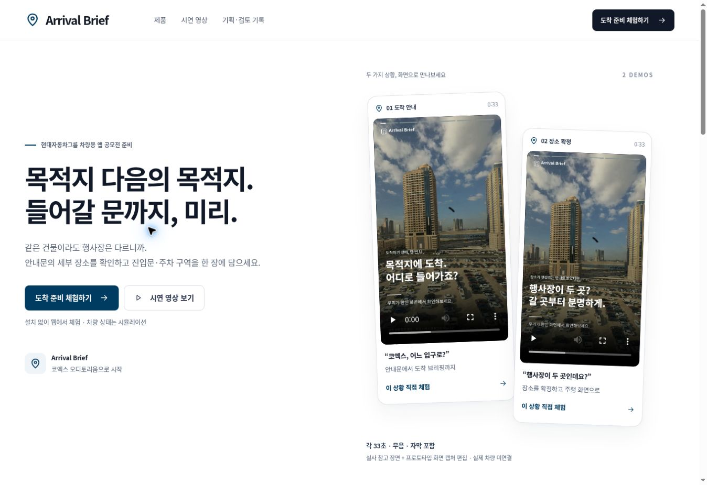

# Arrival Brief

행사 안내문에서 세부 목적지를 확인하고, 출발 전에 진입문과 주차 구역을 정리하는 차량용 앱 프로토타입입니다.

현대자동차그룹 차량용 앱 개발 공모전 준비 프로젝트입니다. 공식 서비스나 제출이 완료된 작품은 아닙니다.



## 사용 흐름

안내문 붙여넣기 → 목적지 확인 → 차량 전체 높이 확인 → 도착 브리핑 확정 → 주행 시 확정 내용만 보기.

- 코엑스 삼성동 8개 목적지의 공식 진입문·주차 구역을 출처와 함께 표시합니다.
- 여러 장소, 취소·변경 문맥, 층 불일치와 높이 제한은 추가 확인 또는 진입 제외로 처리합니다.
- 웹의 정차·주행 상태는 시뮬레이션입니다. 상태를 모르면 입력·복사·저장을 제한합니다.
- 규칙 기반 해석이며 외부 AI API, 계정, 위치 권한이나 API 키 없이 웹 체험이 가능합니다. 입력은 외부 서버로 전송하지 않습니다.

## 실행

Python 3과 최신 Chrome·Edge·Firefox·Safari에서 저장소 최상위 폴더를 엽니다.

```sh
python -m http.server 8000 --bind 127.0.0.1
```

브라우저에서 `http://127.0.0.1:8000/`를 열면 소개 페이지로 이동합니다. 앱은 `/dist/arrival/`에서 실행합니다. 별도 서버·패키지 설치·환경변수 설정은 필요 없습니다.

Android는 JDK 17, Android SDK 35, Android SDK Build-Tools와 SDK 라이선스가 필요합니다. SDK 위치는 `ANDROID_HOME` 또는 로컬 `android/local.properties`로 지정합니다. Gradle 8.13 wrapper가 포함되어 있으며 첫 빌드에는 네트워크가 필요합니다.

```sh
cd android
./gradlew :app:testDebugUnitTest :app:assembleDebug
```

Windows는 `gradlew.bat`를 사용합니다. 환경 설정·인증서·서명키는 저장소에 올리지 않습니다.

## 시험과 확인 범위

저장소 최상위에서 Node.js 18 이상과 Python 3으로 실행합니다.

```sh
node --test tests/arrival.test.mjs
python scripts/check-paths.py
```

현재 웹 엔진 12개 시험과 정적 파일 경로 검사를 통과했습니다. 2026-10-28 Android 빌드 기록은 Kotlin JUnit 8개 통과와 공식 Pleos Vehicle 2.3.2·NaviHelper 3.0.5 컴파일 성공을 보여줍니다. 이번 저장소 분리 과정에서 Android 빌드를 다시 실행하지 않았습니다.

**실제 Pleos 기기·에뮬레이터 실행, 차량 권한 승인, 주행 상태와 `CarUxRestrictions` 연결은 미검증입니다.** 브레이크 페달 진단 값으로 정차 여부를 추정하지 않습니다. 실시간 주차 빈자리, 입구 좌표, 실내 경로와 내비 목적지 전달은 구현 범위에 포함하지 않습니다.

## APK와 시연 영상

| 자료 | 위치 | 상태 |
| --- | --- | --- |
| 개발용 APK | [apk/ArrivalBrief_debug.apk](apk/ArrivalBrief_debug.apk) | Android debug 인증서 서명. 공모전 제출용 release 아님 |
| 도착 준비 영상 | [arrival-reel.mp4](dist/assets/media/arrival-reel.mp4) | 33초, 720×1280, 무음 |
| 목적지 확인 영상 | [arrival-confirm-reel.mp4](dist/assets/media/arrival-confirm-reel.mp4) | 33초, 720×1280, 무음 |

APK SHA-256: `b251608ee160252a4c0c741731f3fa352861bc456537c9df4c4cd8ec5f41b663`.

영상은 실사 스톡 도입과 웹 프로토타입 화면 캡처를 편집한 시연입니다. 실제 차량 촬영·실시간 화면 녹화·사용자 검증 자료가 아닙니다. 한국어 자막 파일은 각 영상과 같은 폴더에 있습니다.

최종 APK 제출 전 참가자 release 서명, Pleos 실행·권한·주행 제한 검증을 마치고 `apk/팀명_ArrivalBrief_release.apk` 형태로 추가해야 합니다. unsigned release 파일과 서명키는 포함하지 않았습니다.

## 문서

- [기획과 구현 범위](docs/ARRIVAL_PLAN.md)
- [검증 기록](docs/HYUNDAI_VERIFICATION.md) · [Android 빌드 근거](docs/ANDROID_BUILD.md)
- [SDK 연동 범위](android/README.md) · [자료 출처와 라이선스](ATTRIBUTIONS.md)
- [공모전 공식 제출 안내](https://appdevchallenge.auto-hmg.io/guide/submission)

코엑스 시설 정보는 2026-10-28 확인한 공개 안내 기준입니다. 실제 방문에서는 최신 공식 안내와 현장 표지를 우선합니다. 개인정보가 담긴 접수양식·서명·포트폴리오는 이 저장소에 포함하지 않습니다.
