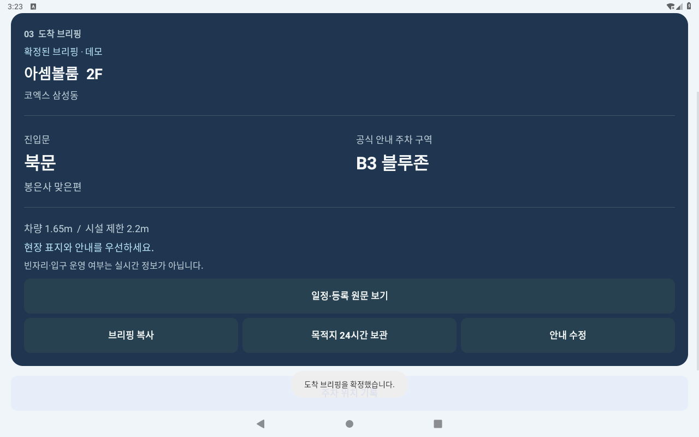

# Arrival Brief — 처음 보는 분을 위한 검토 순서

**“코엑스까지는 내비가 알려주는데, 어느 문과 주차 구역을 써야 할까?”**

Arrival Brief는 행사 안내의 세부 장소를 확인해 출발 전 도착 패스로 만들고, 주차한 뒤에는 운전자가 직접 적은 위치를 남기는 차량용 앱입니다. 첫 범위는 코엑스 삼성동의 지원 회의실입니다. 자동 경로 안내가 아니라, 공식 안내와 사용자의 확인을 연결하는 준비 도구입니다.



RC4 실제 실행 · 확정 화면 · 2026-11-02 · 일반 Android 9 에뮬레이터에서 촬영한 release 앱입니다. 실제 Pleos·차량 촬영이 아닙니다.

## 먼저 볼 세 가지

1. **[현재 RC4 앱 화면](../screenshots/rc4/README.md)** — 서명된 release의 확정 화면과 주차 메모 QR 기본/확대, 표준/큰 글씨 표시를 확인합니다. 캡처별 APK 해시와 원본을 함께 제공합니다.
2. **[실행 APK](../apk/ArrivalBrief_release.apk)** — 일반 Android에서는 안내를 읽고 데모를 시작할 수 있습니다. [설치·빌드 안내](ANDROID_BUILD.md)와 [현재 RC4 앱 스크린샷](../screenshots/rc4/README.md)을 제공합니다.
3. **[구현·시험 근거](verification/release-verification.json)** — 실행한 시험, APK 해시, 환경별 확인 범위를 대조합니다. [사업 검증 계획](BUSINESS_VALIDATION.md)에는 안내문·갱신 검토표·확대 승인표와 실행 가능한 합성 예시가 있습니다.

현재 후보는 `1.0.0-rc4`입니다. [RC3 실제 앱 연속 시연](../dist/assets/media/arrival-native-journey.mp4)은 이전 버전의 흐름 참고이며, 새 QR 확대 기능의 근거는 RC4 스크린샷·검증 JSON입니다. [자막](../dist/assets/media/arrival-native-journey.vtt)과 [촬영 기록](../dist/assets/media/arrival-native-journey.json)을 함께 제공합니다. 영상은 일반 Android 9 에뮬레이터에서 촬영했습니다. 같은 기기의 공유 수신과 주행 데모를 사용하며, 휴대폰→차량 자동 전송이나 실제 Pleos 신호를 입증하지 않습니다. 가변 프레임 원본의 영상 길이와 자동화 경과 시간을 구분하며, 앱 동작 속도를 측정하는 자료가 아닙니다.

## 한 장면으로 확인하는 차이

다음 안내문을 입력합니다. 실제 안내를 가져올 때는 개인정보만 제거하고, 장소·일정·등록 및 변경·취소·진입·주차 제한 문장은 그대로 남깁니다.

```text
학술대회 안내
장소: 코엑스 아셈볼룸 2층
행사는 10:00에 시작하여 18:00에 종료됩니다.
참가 등록은 1층 로비에서 진행합니다.
```

예정된 종료 시간과 등록 장소를 행사장 변경으로 오해하지 않고 **아셈볼룸 2층**을 검토 후보로 보여줍니다. 일정·등록 원문은 접어두었다 펼칠 수 있고 내보내기에도 남습니다. 현재 유효한 행사장, 실제 차량 높이, 안전한 주차 상태를 확인해야 **북문·B3 블루존** 도착 패스를 확정합니다. 확정 후 Android는 준비 영역을 접어 핵심 안내를 크게 보여줍니다.

`종료됩니다`를 `종료되었습니다`로 바꾸거나 실제 제한·상충 안내를 추가하면 보류해야 합니다. 분석 과정에서 원문의 제한을 무시하거나, 제한이 있는 원문을 유지한 채 다른 장소를 골라 확정할 수 없게 합니다. 사용자가 원문을 편집하면 새 입력으로 다시 검토합니다. 지원 문형 밖의 여러 일정·등록 장소를 모두 이해한다고 주장하지 않습니다.

## 심사 관점과 확인할 근거

공식 1차 평가의 네 항목에 맞춰 검토할 수 있도록 연결했습니다. 공개된 가중치나 공식 예상 점수는 없습니다.

| 관점 | 제품에서 확인할 내용 | 근거 |
| --- | --- | --- |
| 차량특화성 | 출발 전 검토와 주행 중 입력 잠금, 행사장별 진입문·주차, 하차 전 메모 | [실제 앱 시연](../dist/assets/media/arrival-native-journey.mp4) · [제품 범위](PRODUCT_SCOPE.md) |
| 창의성 | 일정·등록·행사장 분리, 공식 자료 상충 시 근거를 보여주며 보류, 확인 후 집중 패스 | [개발 사례 전후 비교](verification/award-scenarios.md) · [독립 경계 검토](verification/award-independent-review.md) |
| 기술 활용성 | NaviHelper 목적지 시설 대조, CarUxRestrictions 제한·미확인 시 잠금 | [Android 연동 범위](../android/README.md) · [환경별 검증](verification/android-runtime.md) |
| 사업성 | 행사 운영자를 통한 제한된 도입 가설, 차량 설치·원문 전달 병목, MAU·반복 이용 정의 | [사업 검증 계획](BUSINESS_VALIDATION.md) · [운영자 양식과 예시](../examples/organizer/README.md) |

출처: [공식 심사·시상 안내](https://appdevchallenge.auto-hmg.io/guide/judging-awards), 2026-11-02 확인. 이는 공식 채점·수상 전망이 아닙니다.

## 이번 버전의 확인된 개선

- QR이 잘 읽히지 않을 때 **QR 크게 보기**로 바꾸고 **기본 크기**로 돌아갈 수 있습니다. 메모와 저장 시각은 같고, 다시 표시할 때도 주차·입력 허용·만료 조건을 검사합니다. 화면 여유가 없으면 확대 버튼을 숨깁니다.
- 입력 도움말이 장소·일정·등록뿐 아니라 변경·취소·진입·주차 제한을 원문대로 남기도록 안내합니다. 제한 문장을 삭제해 통과시키라는 안내를 하지 않습니다.
- RC4 Android 단위 시험 77개·웹 60개와 공통 판단 입력 433건을 통과했습니다. 공통 입력 수를 시험 수에 다시 더하지 않습니다.
- RC4 QR 중심 UI는 4개 시나리오와 글자 크기 1.3배에서 같은 4개를 반복 검증했습니다. 전체 19개 UI 시나리오를 이번에 다시 실행했다는 뜻은 아닙니다.
- RC4 실제 앱 QR 8장×두 판독기는 16/16입니다. 원본 8장에 대한 두 판독기의 16회 비교가 모두 저장 원문·시각과 일치했습니다. [캡처 판독 기록](verification/completion-qr-rc4.json).
- 지원 Pleos PC에서 결과를 모으는 읽기 전용 수집기를 준비했습니다. 합성 응답 기반 검사 8개 통과와 실제 Pleos·SDK 응답 검증은 별개입니다.

RC3의 개발 사례 10/10, 후속 경계 웹·Kotlin 각 76/76, 운영자 합성 예시 8/8은 당시 기록으로 보존합니다. 구현 과정의 합성 검사를 실제 사용자 정확도·채택·효과·매출이나 RC4 재실행 결과로 해석하지 않습니다.

## 다음 단계에서 필요한 증거

실제 Pleos 환경의 설치·NaviHelper 응답·UX 제한 전환, 실물 휴대폰의 QR 판독, 동의한 이용자·운영자 과업 관찰은 아직 완료하지 않았습니다. RC3의 QR 판독 5/6과 release 미판독 1건은 [이전 결과](verification/completion-qr-rc3.json)에 보존합니다. 같은 payload의 크기 비교에서는 400px와 480px 모두 각 98/100이었으며 실패 조합이 달랐습니다. 확대를 모든 판독 실패의 해결로 주장하지 않습니다. 특히 차량 기기 안에서 앱 설치와 안내문 전달을 함께 재현하는 것이 배포 검증의 선행 조건입니다. 이 범위를 [검증 게이트](BUSINESS_VALIDATION.md)에 명시했습니다.

이전 RC3·RC2 영상·스크린샷·검증 기록은 당시 증거로 보존합니다. 현재 결과는 RC4 명시 파일과 최신 JSON을 기준으로 확인하세요.
