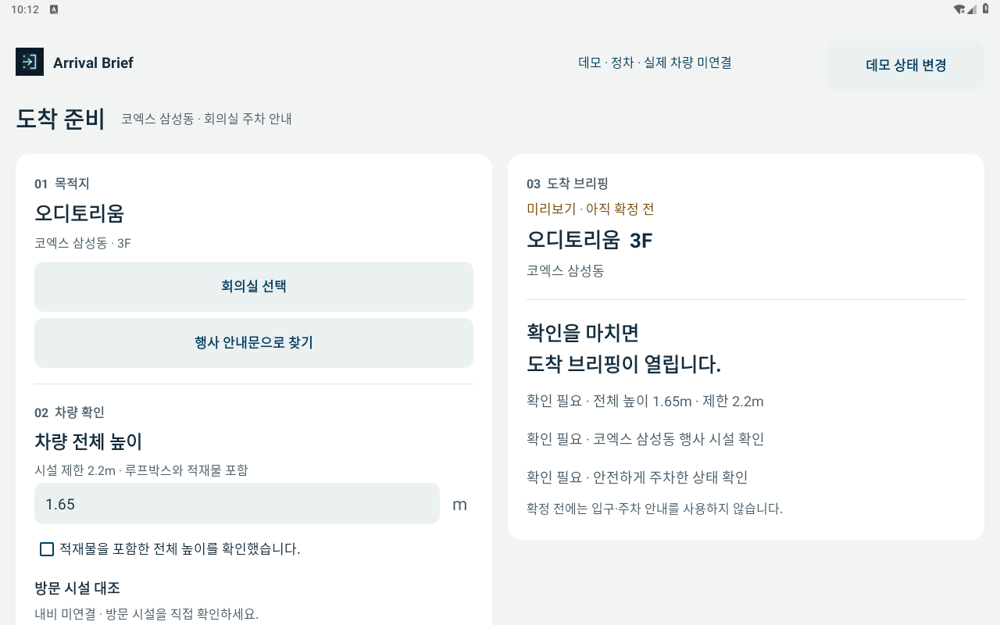
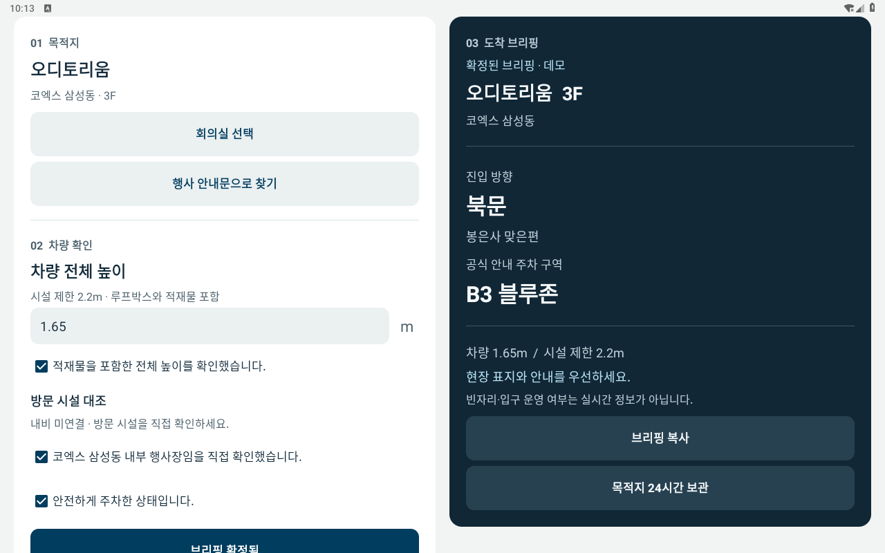
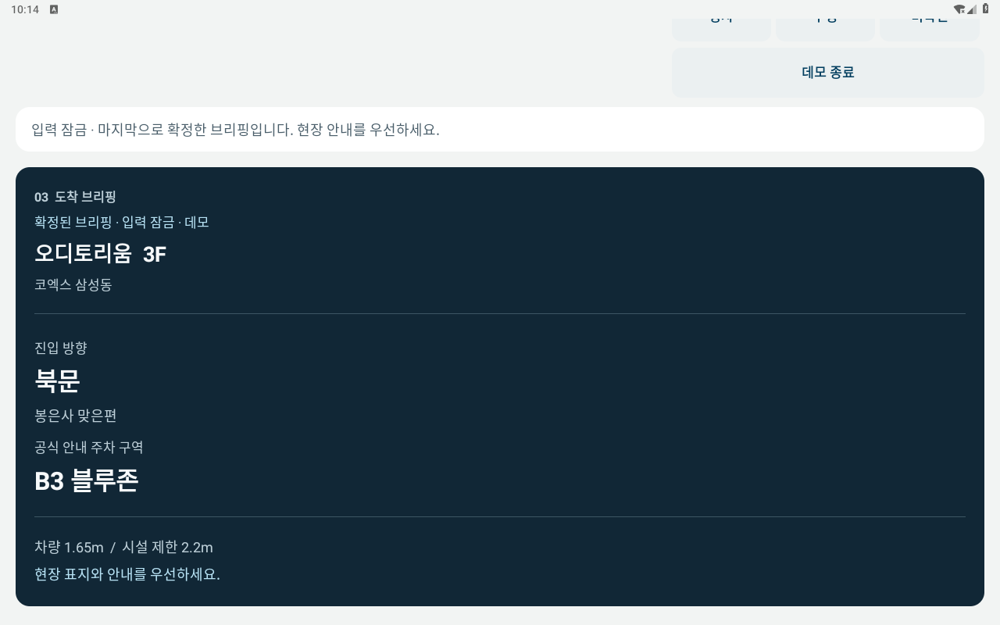
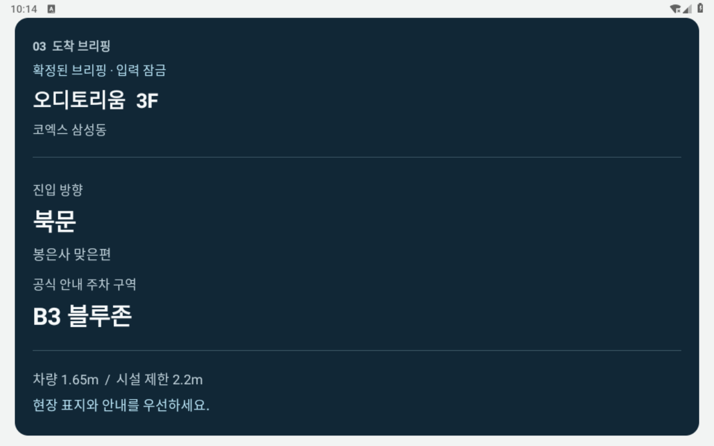

# Android 런타임 실행 기록

## 현재 1.0.0-rc2 검증 — 2026-11-02 UTC

최종 서명 release APK는 AOSP Android 9(API 28, x86, 1280×800)에서 기존 최종 RC1(versionCode 10) 위로 업데이트 설치되어 `Success`를 반환했다. RC2(versionCode 11)의 첫 실행은 `Status: ok`와 `Complete`였으며, 기기 안 `base.apk`의 SHA-256은 아래 배포 파일과 일치했다.

| 항목 | 최종 결과 |
| --- | --- |
| 버전·파일 크기 | `1.0.0-rc2`, versionCode 11, 6,659,947 bytes |
| release APK SHA-256 | `779d69f709e16a9ec2a4ffb9de235d908f442c4f8dd25bc80fd574c12d003f0f` |
| 빌드 입력 | Android 소스·리소스·설정과 공통 fixture 43개가 성공한 격리 빌드와 작업 소스에서 바이트 일치 |
| 빌드·정적 검증 | Android 단위 74개, 웹 55개, 공통 판단 사례 387개 통과; Lint 오류·경고 0개 |
| 실제 앱 UI 검증 | 같은 main 소스의 별도 debug APK에서 고유 시나리오 16개 통과 |
| 큰 글씨 검증 | 글자 배율 1.3에서 기존 시나리오 6개 반복 통과; 고유 시나리오 수에 중복 합산하지 않음 |
| 실행 로그 | 앱 관련 FATAL/ANR 시그니처 0건; release 구간의 별도 OS `cmd` SIGSEGV 1건 보존·구분 |
| 아이콘 | 생성 원본과 패키지 이미지의 디코딩 픽셀 일치; adaptive/round/monochrome 리소스 및 Android 9 시스템 앱정보 화면 표시 확인 |

[현재 release 검증 JSON](release-verification.json), [RC2 런타임 상세](android-runtime-rc2.json), [빌드 입력 해시](build-inputs-rc2.json), [release 설치·실행 로그](android-aosp28-rc2-release.txt), [표준 UI 16개](android-aosp28-rc2-ui-standard.log), [큰 글씨 6개](android-aosp28-rc2-ui-largefont.log), [아이콘 검증](android-aosp28-rc2-icon.json)이 근거다. 서명 release의 설치·실행과 별도 debug instrumentation의 조작 시험을 구분한다. 실제 화면은 [첫 실행](android-aosp28-rc2-release.png), [확정 브리핑](android-aosp28-rc2-confirmed.png), [400dp QR](android-aosp28-rc2-qr.png), [큰 글씨 QR](android-aosp28-rc2-large-qr.png), [시스템 아이콘](android-aosp28-rc2-system-icon.png)에서 확인할 수 있다. Android 13 테마 아이콘의 실제 표시는 검증하지 않았다.

[로그 검토](android-aosp28-rc2-log-review.json)와 [전체 수집 로그](android-aosp28-rc2-logcat.txt)에 OS 명령 프로세스 `cmd`(PID 3164)의 SIGSEGV 1건을 보존했다. 앱 프로세스는 PID 3166으로 구분되며, `am start -W`는 exit 0·`Status: ok`를 반환하고 이후 앱 화면·PID·기기 APK 해시가 확인됐다. 표준·큰 글씨 UI 로그에는 FATAL/ANR 시그니처가 없다. OS 명령 프로세스 오류의 근본 원인은 확정하지 않으며 환경 전체가 충돌 없이 동작했다고 주장하지 않는다. 두 시험이 끝난 뒤 runner가 종료를 요청했으며 에뮬레이터 launcher 종료 코드는 관측값 `-10`으로 기록했다.

영문 `Room 300`, 음수 `-3층`, `B03층`·`B0층` 입력을 수동 오디토리움 선택으로 덮어써 확정할 수 없는지 실제 화면에서 검사했다. [영문 방 번호](android-aosp28-rc2-english-room-manual-blocked.png), [음수 층](android-aosp28-rc2-negative-floor-manual-blocked.png), [B03층](android-aosp28-rc2-basement-b03-manual-blocked.png), [B0층](android-aosp28-rc2-basement-b0-manual-blocked.png)은 각각 원문이 보존된 캡처다. 공통 fixture 387건을 별도 UI 387개나 실차 시험 387회로 계산하지 않는다.

[연속 원본 화면 녹화](android-aosp28-rc2-ui-first180.mp4)는 제한을 180초로 설정했으며 실제 파일 길이는 **179.083833초**다. [30초 설명 영상](../../dist/assets/media/arrival-native-validation.mp4)은 이번 최종 debug UI 캡처 5장을 편집한 영상이다. [영상 메타데이터](../../dist/assets/media/arrival-native-validation.json)의 release/debug APK 해시와 각 `packaged_screenshot` 경로·SHA-256을 실제 파일과 대조했다. 이 영상은 연속 녹화나 Pleos 서비스 성공 영상이 아니다.

QR은 최대 400dp와 화면 크기를 함께 고려해 표시하며 초점 안내를 제공한다. 앱 내부 QR 디코딩 시험과 [별도 두 디코더 검증](completion-qr.md)은 물리 휴대전화 카메라 스캔과 구분한다. 휴대폰 복사본은 앱의 24시간 만료·삭제로 자동 삭제되지 않는다.

### Pleos: RC2 설치·SDK 응답은 미검증

이 RC2 APK를 Pleos에 설치하거나 실행한 성공 기록은 없다. [2026-11-02 추가 진단](completion-pleos.md)과 [상세 JSON](completion-pleos.json)은 공식 이미지의 별도 쓰기 가능한 clone을 4 vCPU·4GiB·소프트웨어 렌더링으로 480초 한도(정리 포함 481.22초) 실행한 결과다. package/activity 서비스까지 도달했으나 `sys.boot_completed=1`이 확인되지 않아 APK 설치를 시도하지 않았다. 요청한 timeout multiplier와 Watchdog 설정은 적용되지 않았으며, 원래 AVD와 시스템 이미지는 보존됐다. 이 진단의 시작 시점 APK 표시는 RC1이며 RC2 검증으로 승계하지 않는다.

아래 보존된 RC1의 20분 시도 역시 앱 설치 전에 OS Watchdog으로 차단된 기록이다. 현재 환경에는 GPU/KVM이 없지만 이를 유일한 실패 원인으로 확정하지 않는다. 실제 NaviHelper 목적지 콜백, CarUxRestrictions 전환, 실차 동작과 물리 휴대전화 QR 스캔은 미검증이다. AOSP는 비차량 데모이며 CPU 에뮬레이션의 시간 기록은 성능 측정이 아니다.

## 보존된 1.0.0-rc1 검증 — 2026-11-02 UTC 기록

최종 release APK는 AOSP Android 9(API 28, x86, 1280×800)에서 원래 서명키의 이전 후보 위로 업데이트 설치되어 `Success`를 반환했고, 첫 실행에서 `Status: ok`와 `Complete`를 확인했다. 기기 안 `base.apk`의 SHA-256도 아래 배포 파일과 일치했다. 이 구간의 실행일은 2026-11-01 UTC다.

| 항목 | 최종 결과 |
| --- | --- |
| 버전·파일 크기 | `1.0.0-rc1`, versionCode 10, 6,658,807 bytes |
| release APK SHA-256 | `04114df0de41218e21b293609e6625983f4eb615d77ade959ec3bb2a8c48e8bf` |
| 빌드·정적 검증 | Android 단위 73개, 웹 50개, 공통 판단 사례 287개 통과; Lint 오류·경고 0개 |
| 실제 앱 UI 검증 | 동일한 main 소스의 별도 debug APK에서 고유 시나리오 13개 통과 |
| 큰 글씨 검증 | 글자 배율 1.3에서 기존 시나리오 6개 반복 통과; 추가 고유 시나리오로 합산하지 않음 |
| 실행 로그 | release 첫 실행·표준 UI·큰 글씨 UI의 수집 로그에서 FATAL/ANR 시그니처 0건 |
| 새 아이콘 | 패키지 안 이미지의 디코딩 픽셀이 생성 원본과 일치; adaptive/round/monochrome 리소스 포함; Android 9 시스템 앱정보 화면의 표시 확인 |

[최종 빌드·release 검증 JSON](release-verification-rc1.json), [런타임 상세 JSON](android-runtime-rc1.json), [빌드 입력 43개 해시](build-inputs-rc1.json), [아이콘 검증](android-aosp28-rc1-icon.json)이 근거다. 실제 화면은 [첫 실행](android-aosp28-rc1-release.png), [확정 브리핑](android-aosp28-rc1-confirmed.png), [자동으로 전체 표시된 QR](android-aosp28-rc1-qr.png), [큰 글씨 QR](android-aosp28-rc1-large-qr.png), [시스템 아이콘](android-aosp28-rc1-system-icon.png)에서 확인할 수 있다. Android 13 테마 아이콘의 실제 표시는 검증하지 않았다.

[연속 원본 화면 녹화](android-aosp28-rc1-ui-first180.mp4)는 녹화 제한을 180초로 설정했으며 실제 파일 길이는 **178.357422초**다. [30초 설명 영상](../../dist/assets/media/arrival-native-validation-rc1.mp4)은 최종 debug UI 캡처 5장을 편집한 영상이며 연속 녹화가 아니다. [편집 영상 메타데이터](../../dist/assets/media/arrival-native-validation-rc1.json)의 각 화면 경로·SHA-256은 제출 폴더의 실제 캡처와 일치한다.

### 최종 Pleos 재시도: 앱 설치 전 OS 부팅 차단

2026-11-01 23:54:37부터 2026-11-02 00:14:38 UTC까지 공식 Pleos Connect 2.1.0(API 34, x86_64) 이미지를 단독으로 재시도했다. 부팅·검증 예산은 20분이며 종료 정리를 포함한 기록은 1201.37초다. ADB, SurfaceFlinger, package/activity 서비스까지 도달했으나 `sys.boot_completed=1`에는 도달하지 못했다. **최종 APK 설치 명령은 실행되지 않았고, 앱 실행·NaviHelper 목적지 응답·실제 CarUxRestrictions 전환은 검증되지 않았다.**

첫 `system_server`와 자동 재시작된 `system_server`가 각각 main 스레드 131초·129초 정체로 guest Watchdog에 의해 종료됐다. 두 종료 시점의 stack은 `PermissionPolicyService.grantOrUpgradeDefaultRuntimePermissionsIfNeeded → CompletableFuture.get` 대기를 보여준다. 해당 권한 콜백이 보고된 정체 시간 전체를 차지했다고 단정하지 않으며, 근본 원인은 확정하지 않았다. 후속 SystemUI `DeadSystemException`은 시스템 종료 이후의 결과다. 이 시도에서 host OOM 카운터 증가는 0이었고 VM은 예산 종료 뒤 정상 정리됐다. 앱은 설치되기 전이므로 앱 설치 실패나 앱 자체 충돌로 분류하지 않는다.

근거: [최종 Pleos 요약](pleos-final-04114df-summary.json), [전체 명령·관찰 상태 JSON](pleos-final-04114df-runtime.json), [부팅 관찰](pleos-final-04114df-observations.log), [선별 시스템 로그](pleos-final-04114df-selected-logcat.log). 현재 호스트에는 GPU/KVM이 없으며, GPU 부재를 위 실패의 단일 원인으로 확정하지 않는다. 지원 환경에서 설치·SDK 응답·실제 주행 규제 전환을 다시 확인해야 한다.

AOSP 결과는 일반 Android의 비차량 데모다. QR 비트맵의 내용 디코딩은 시험했지만 물리 휴대전화 카메라 스캔, 실차 동작, 장시간 안정성 및 성능 측정은 포함하지 않는다. 아래 이전 버전 기록은 당시 관측 이력으로 보존하며 현재 RC1의 검증 범위와 구분한다.

## 이전 기록 — 2026-10-30 이후

기록 기준일: 2026-10-30 UTC. release APK의 빌드·서명과 구분한 실행 기록이다. Pleos 시도는 **시스템 초기화 실패로 APK 설치를 완료하지 못한 상태**다. 아래 일반 Android 9의 0.3.0 실행 결과는 비차량 데모이며 Pleos SDK·차량 신호 성공 기록이 아니다.

## 사용한 이미지와 환경

| 항목 | 확인 내용 |
| --- | --- |
| 공식 이미지 | Pleos Connect Emulator v2.1.0, API 34, x86_64 |
| 이미지 SHA-1 | `b4f858d5bcc6c71506d7edfc872bcb9e5a11acaa` 일치 확인 후 부팅 시도 |
| 실행 환경 | GPU 없음, KVM 없음 |
| 부팅 완료 | `sys.boot_completed` 완료 상태를 확인하지 못함 |
| 앱 설치 | `adb install`에서 시스템 오류로 실패 |
| 첫 실행·SDK·UX 제한 전환 | 설치 미완료로 확인하지 못함 |

[공식 Pleos 에뮬레이터 설정 문서](https://document.pleos.ai/docs/connect/guide/getting-started/application-development/configure-pleos-connect-emulator)는 실행에 그래픽 카드가 필요하다고 명시한다. 현재 환경은 이 요구사항을 충족하지 않는다. KVM이 없다는 사실도 실행 환경의 제약으로 기록하되, 해당 문서가 KVM을 필수로 규정한다고 해석하지 않는다.

이미지 해시가 일치해도 운영체제 부팅이나 앱 실행이 검증되는 것은 아니다. 에뮬레이터 자체의 사전 점검에 통과 메시지가 있더라도 공식 그래픽 카드 요구사항 충족 여부와 구분한다.

## 관측 결과

부팅을 시도했으나 시스템 초기화가 완료되지 않았다. 게스트 오류 로그에서 `com.android.systemui`와 `com.android.permissioncontroller`의 종료 및 다음 오류를 확인했다. 시각·프로세스 ID·임시 경로는 생략하고 오류 문구만 발췌했다.

```text
FATAL EXCEPTION: main
Process: com.android.systemui
DeadSystemException: The system died; earlier logs will point to the root cause

FATAL EXCEPTION: main
Process: com.android.permissioncontroller
DeadSystemException: The system died; earlier logs will point to the root cause
```

`adb install`도 `PackageManagerInternal.freeStorage` 호출 대상이 null인 시스템 오류로 실패했다. 이 설치 오류는 명령 실행의 도구 출력에서 확인했고 별도 원문 파일로 저장하지 않았으므로, 여기에는 오류 요약만 기록한다. APK 설치 성공이나 앱 자체의 실행 중 충돌로 분류하지 않는다.

부팅·게스트 로그의 원본 이름은 `emulator-current.log`, `guest-crashes.log`다. 환경별 임시 경로와 전체 로그는 저장소에 복사하지 않고 위 최소 발췌를 남겼다.

## 판단과 한계

확인한 사실은 공식 환경 요구사항을 충족하지 않는 환경에서 OS 초기화가 실패했고 앱 설치도 완료되지 않았다는 것이다. **GPU 부재를 실패의 단일 원인으로 확정하지 않는다.** 현재 기록만으로 다른 시스템 오류 원인을 배제하거나 APK의 호환성·정상 실행 여부를 판정할 수 없다.

이 실행 시도는 다음 결과를 바꾸지 않는다.

- release APK `0.2.0-prototype`의 컴파일·서명 확인
- Android JUnit 23개와 웹 엔진 14개 테스트 통과
- 실제 Pleos 앱 설치·서비스 연결·UX 제한 전환은 아직 검증되지 않았다는 상태

이전 Pleos 시도 대상은 0.2.0 APK이며 SHA-256은 다음과 같다. 현재 경로의 APK는 0.4.0으로 교체되었다.

```text
079ce46a3b6f5660e8808d0109033c5004c9fa8d910ac93d68668cdb2d0df16e
```

## 재검증 조건

공식 그래픽 카드 요건을 충족하는 환경에서 에뮬레이터를 다시 구성한다. 공식 문서의 cold boot 설정에 따라 시작하고, OS 부팅과 패키지 서비스가 정상인지 확인한 뒤 APK를 설치한다. 이후 첫 실행, CarUxRestrictions 제한·해제, 서비스 연결 해제·재연결, NaviHelper 목적지 응답을 각각 기록한다.

주행 중 운영체제가 앱 화면 전체를 제한할 수 있다는 점도 확인 대상이다. 지금의 시뮬레이션과 단위 테스트를 실제 차량 화면 표시 성공으로 대체하지 않는다.

관련 문서: [Android 빌드·서명](../ANDROID_BUILD.md) · [전체 검증 기록](../HYUNDAI_VERIFICATION.md).

## 이전 0.2.0 일반 Android 9 설치와 첫 실행

차량 플랫폼과 별도로 공식 AOSP Android 9(API 28) x86 에뮬레이터에 동일한 release APK를 설치했다. 이미지 `x86-28_r04.zip`의 SHA-1 `ce03c42d80c0fc6dc47f6455dbee7aa275d02780`을 확인했다. 화면은 1280×800, 160dpi, 메모리 2GB, 소프트웨어 렌더링·CPU 에뮬레이션 환경이다.

- `adb install -r`: `Success` 확인.
- `am start -W -n studio.ax.arrival/.MainActivity`: `Status: ok`, Activity 이름 및 `Complete` 확인.
- 첫 화면: 차량 상태 미확인과 입력 잠금 표시.
- 별도 데모 버튼: 실제 차량 상태를 읽지 않는다는 안내 확인 후 시작.
- 데모 시작 후: 2열 화면, 오디토리움 3층·북문·B3 블루존, 전체 높이 1.65m 표시 확인.

- 전체 높이와 안전한 주차 확인을 선택한 뒤 브리핑 확정 상태 확인.
- 주행 예시로 전환: 입력·복사 영역 잠금, 확정한 브리핑 유지 확인.


이 화면은 일반 Android 에뮬레이터에서 실행한 네이티브 앱의 캡처이며 Pleos 차량 화면이 아니다. 테스트 중 Android System UI의 응답 지연 경고를 닫은 뒤 앱 조작을 이어갔다. 현재 환경에서 응답 시간이나 안정성을 성능 지표로 삼지 않는다. 실제 차량 신호·SDK 응답과 장시간 안정성은 이 결과에 포함되지 않는다.


## 0.3.0 일반 Android 9 실행 검증

동일 AOSP 환경에 최신 서명 APK를 `adb install -r`로 업그레이드해 `Success`를 확인했다. `am start -W`는 `Status: ok`와 `studio.ax.arrival/.MainActivity`를 반환했다. 버전은 0.3.0-prototype/versionCode 3, APK SHA-256은 `2c8c4e1c99ce27f1f5fc988ac1343476cfae24a5d6b30a5bcafea65271eb31c2`다.

- 첫 실행은 차량 상태 미확인으로 입력을 잠갔다. 별도 안내를 확인한 뒤 비차량 데모를 시작했다.
- 데모는 오디토리움과 높이 1.65m를 예시로 채운다. 시설 수동 확인·전체 높이 확인·안전 주차 확인을 모두 선택한 뒤 확정 버튼이 활성화됐다.
- 확정한 오디토리움의 북문·B3 블루존 안내와 저장 동작을 확인했다. 주행 예시에서는 입력·복사를 숨기고 확정 브리핑을 유지했다.
- 목적지만 명시적으로 저장한 뒤 앱 프로세스를 종료하고 다시 실행했다. 보관한 목적지는 남지만 확정 브리핑은 자동 복구되지 않았다.
- 다시 데모에 들어가 보관한 목적지를 불러오면 이름·층으로 만든 새 초안이 표시됐다. 높이는 빈칸이고 시설·높이·주차 체크는 해제되며 확정 버튼은 비활성 상태였다.

- 삭제 버튼을 누른 뒤 보관한 목적지가 없다는 표시와 비활성 복구 버튼을 확인했다.


이 실행에서는 실제 차량 NaviHelper 응답을 받지 않았다. 데모가 시설 수동 확인을 요구하는 화면을 확인한 것이며 SDK 연결 성공이 아니다. 호스트가 하드웨어 가속을 제공하지 않아 System UI 응답 지연 경고를 닫았고 UIAutomator도 일부 시도에서 null root를 반환했다. 화면 캡처와 직접 조작으로 위 흐름을 확인했으며 응답 속도나 안정성 수치를 제시하지 않는다.


## 0.4.0 UI 개편 실행 검증

기록일: 2026-10-31(KST). 공식 AOSP Android 9(API28) x86 이미지에서 새 release APK를 원래 서명키로 업그레이드 설치했습니다. `adb install -r`의 `Success`, `am start -W`의 `Status: ok`와 `Complete`를 확인했습니다. 버전은 0.4.0-prototype/versionCode 4입니다. APK SHA-256: `40ce148be83d608acae1e7bd1bb381619c8ad7896ee7f01fa2cd354d6e4a276f`.

- 첫 실행은 차량 상태 미확인으로 입력을 숨깁니다. 차량 밖에서 데모를 시작하는 안내는 별도 확인이 필요합니다.
- 정차 데모는 오디토리움과 1.65m 예시를 채우지만 입구·주차 경로는 아직 보여주지 않습니다. 시설·전체 높이·안전 주차 확인이 모두 선택되기 전에는 확정 버튼이 비활성입니다.
- 세 조건을 확인하면 버튼과 우측 확인 목록이 바뀝니다. 확정 시 짙은 브리핑에 북문·B3블루존이 표시되며 결과 시작으로 이동합니다.
- 주행 시뮬레이션에서는 입력·복사·보관 조작이 사라지고 확정된 브리핑과 입력 잠금 표시를 유지합니다.
- 1280×800, 160dpi에서 정차/확정/주행 화면을 확인했습니다. 논리 화면 960×600에서도 목적지·진입문·주차구역·높이·현장 표지 우선 문구가 보였습니다. 해당 캡처는 에뮬레이터의 1280×800 프레임버퍼에 스케일된 원본입니다.









이 기록은 실제 차량이나 Pleos SDK 응답 검증이 아닙니다. GPU/KVM 없는 소프트웨어 에뮬레이션에서 초기 Android System UI 응답 지연 경고를 닫은 뒤 확인했습니다. 앱 성능·장기 안정성 수치를 측정하지 않았습니다. 목적지 저장 후 프로세스 종료·복구·삭제 UI 흐름은 이번 0.4.0 실행에서 반복하지 않았으며 위 0.3.0 관측 기록과 구분합니다. 현재 저장 동작의 회귀 조건은 단위테스트로 확인했습니다.
