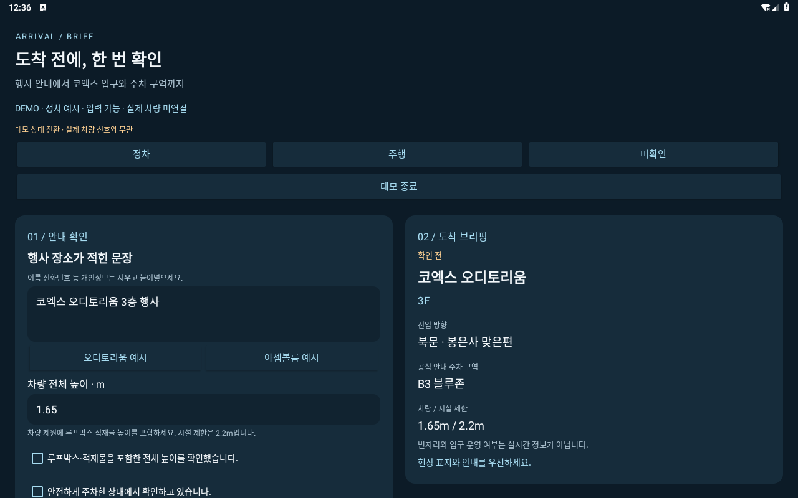
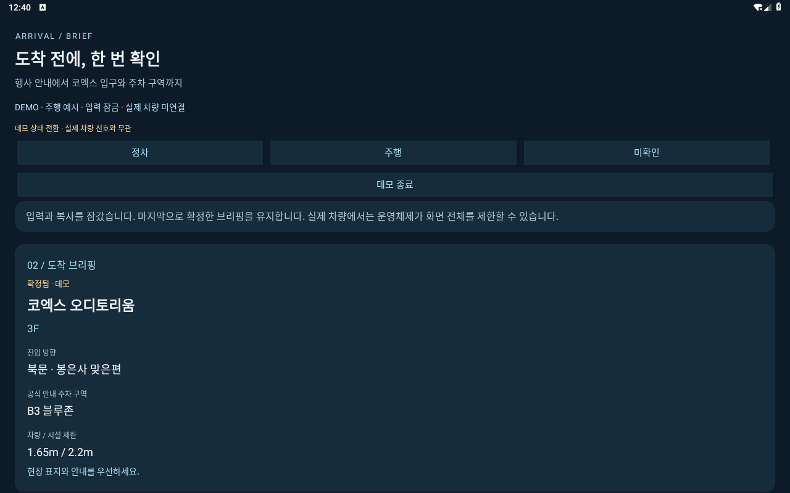
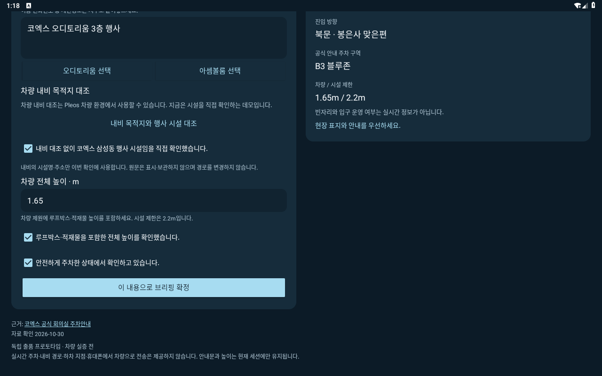
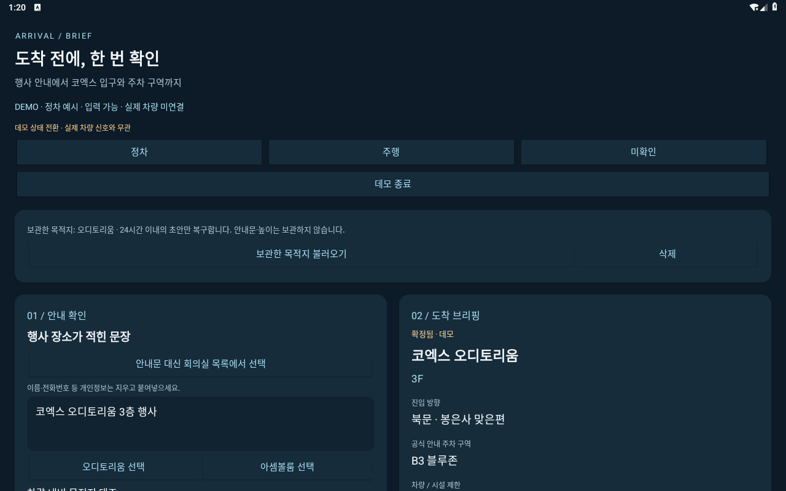
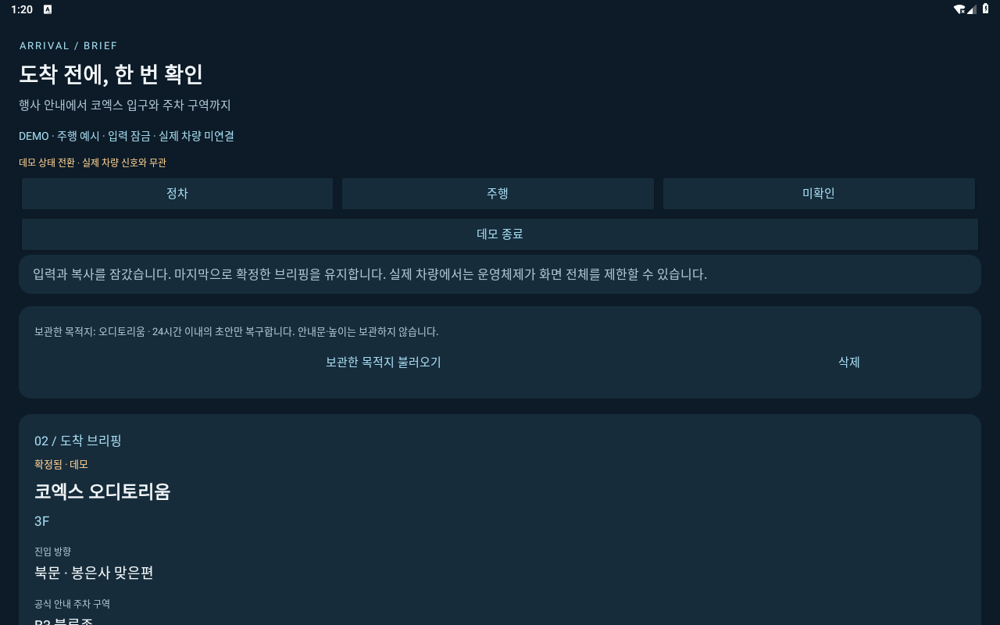
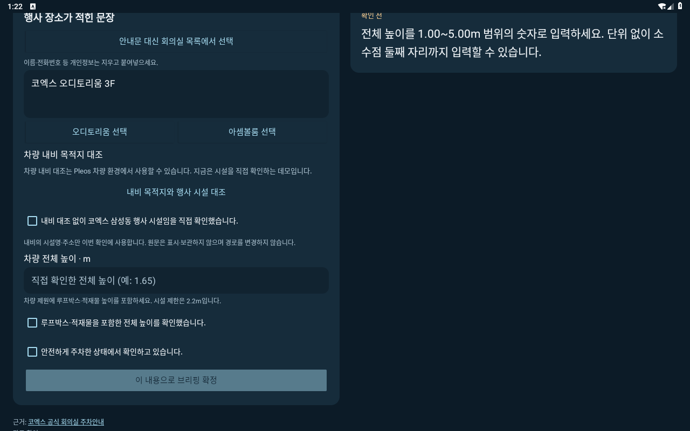

# Android 런타임 실행 기록

기록 기준일: 2026-10-30 UTC. release APK의 빌드·서명과 구분한 실행 기록이다. Pleos 시도는 **시스템 초기화 실패로 APK 설치를 완료하지 못한 상태**다. 아래 일반 Android 9의 0.3.0 실행 결과는 비차량 데모이며 Pleos SDK·차량 신호 성공 기록이 아니다.

## 사용한 이미지와 환경

| 항목 | 확인 내용 |
| --- | --- |
| 공식 이미지 | Pleos Connect Emulator v2.1.0, API 34, x86_64 |
| 이미지 SHA-1 | `b4f858d5bcc6c71506d7edfc872bcb9e5a11acaa` 일치 확인 후 부팅 시도 |
| 실행 환경 | GPU 없음, KVM 없음 |
| 부팅 완료 | `sys.boot_completed` 완료 상태를 확인하지 못함 |
| 앱 설치 | `adb install`에서 시스템 오류로 실패 |
| 첫 실행·SDK·UX 제한 전환 | 설치 미완료로 확인하지 못함 |

[공식 Pleos 에뮬레이터 설정 문서](https://document.pleos.ai/docs/connect/guide/getting-started/application-development/configure-pleos-connect-emulator)는 실행에 그래픽 카드가 필요하다고 명시한다. 현재 환경은 이 요구사항을 충족하지 않는다. KVM이 없다는 사실도 실행 환경의 제약으로 기록하되, 해당 문서가 KVM을 필수로 규정한다고 해석하지 않는다.

이미지 해시가 일치해도 운영체제 부팅이나 앱 실행이 검증되는 것은 아니다. 에뮬레이터 자체의 사전 점검에 통과 메시지가 있더라도 공식 그래픽 카드 요구사항 충족 여부와 구분한다.

## 관측 결과

부팅을 시도했으나 시스템 초기화가 완료되지 않았다. 게스트 오류 로그에서 `com.android.systemui`와 `com.android.permissioncontroller`의 종료 및 다음 오류를 확인했다. 시각·프로세스 ID·임시 경로는 생략하고 오류 문구만 발췌했다.

```text
FATAL EXCEPTION: main
Process: com.android.systemui
DeadSystemException: The system died; earlier logs will point to the root cause

FATAL EXCEPTION: main
Process: com.android.permissioncontroller
DeadSystemException: The system died; earlier logs will point to the root cause
```

`adb install`도 `PackageManagerInternal.freeStorage` 호출 대상이 null인 시스템 오류로 실패했다. 이 설치 오류는 명령 실행의 도구 출력에서 확인했고 별도 원문 파일로 저장하지 않았으므로, 여기에는 오류 요약만 기록한다. APK 설치 성공이나 앱 자체의 실행 중 충돌로 분류하지 않는다.

부팅·게스트 로그의 원본 이름은 `emulator-current.log`, `guest-crashes.log`다. 환경별 임시 경로와 전체 로그는 저장소에 복사하지 않고 위 최소 발췌를 남겼다.

## 판단과 한계

확인한 사실은 공식 환경 요구사항을 충족하지 않는 환경에서 OS 초기화가 실패했고 앱 설치도 완료되지 않았다는 것이다. **GPU 부재를 실패의 단일 원인으로 확정하지 않는다.** 현재 기록만으로 다른 시스템 오류 원인을 배제하거나 APK의 호환성·정상 실행 여부를 판정할 수 없다.

이 실행 시도는 다음 결과를 바꾸지 않는다.

- release APK `0.2.0-prototype`의 컴파일·서명 확인
- Android JUnit 23개와 웹 엔진 14개 테스트 통과
- 실제 Pleos 앱 설치·서비스 연결·UX 제한 전환은 아직 검증되지 않았다는 상태

이전 Pleos 시도 대상은 0.2.0 APK이며 SHA-256은 다음과 같다. 현재 경로의 APK는 0.3.0으로 교체되었다.

```text
079ce46a3b6f5660e8808d0109033c5004c9fa8d910ac93d68668cdb2d0df16e
```

## 재검증 조건

공식 그래픽 카드 요건을 충족하는 환경에서 에뮬레이터를 다시 구성한다. 공식 문서의 cold boot 설정에 따라 시작하고, OS 부팅과 패키지 서비스가 정상인지 확인한 뒤 APK를 설치한다. 이후 첫 실행, CarUxRestrictions 제한·해제, 서비스 연결 해제·재연결, NaviHelper 목적지 응답을 각각 기록한다.

주행 중 운영체제가 앱 화면 전체를 제한할 수 있다는 점도 확인 대상이다. 지금의 시뮬레이션과 단위 테스트를 실제 차량 화면 표시 성공으로 대체하지 않는다.

관련 문서: [Android 빌드·서명](../ANDROID_BUILD.md) · [전체 검증 기록](../HYUNDAI_VERIFICATION.md).

## 이전 0.2.0 일반 Android 9 설치와 첫 실행

차량 플랫폼과 별도로 공식 AOSP Android 9(API 28) x86 에뮬레이터에 동일한 release APK를 설치했다. 이미지 `x86-28_r04.zip`의 SHA-1 `ce03c42d80c0fc6dc47f6455dbee7aa275d02780`을 확인했다. 화면은 1280×800, 160dpi, 메모리 2GB, 소프트웨어 렌더링·CPU 에뮬레이션 환경이다.

- `adb install -r`: `Success` 확인.
- `am start -W -n studio.ax.arrival/.MainActivity`: `Status: ok`, Activity 이름 및 `Complete` 확인.
- 첫 화면: 차량 상태 미확인과 입력 잠금 표시.
- 별도 데모 버튼: 실제 차량 상태를 읽지 않는다는 안내 확인 후 시작.
- 데모 시작 후: 2열 화면, 오디토리움 3층·북문·B3 블루존, 전체 높이 1.65m 표시 확인.

- 전체 높이와 안전한 주차 확인을 선택한 뒤 브리핑 확정 상태 확인.
- 주행 예시로 전환: 입력·복사 영역 잠금, 확정한 브리핑 유지 확인.





이 화면은 일반 Android 에뮬레이터에서 실행한 네이티브 앱의 캡처이며 Pleos 차량 화면이 아니다. 테스트 중 Android System UI의 응답 지연 경고를 닫은 뒤 앱 조작을 이어갔다. 현재 환경에서 응답 시간이나 안정성을 성능 지표로 삼지 않는다. 실제 차량 신호·SDK 응답과 장시간 안정성은 이 결과에 포함되지 않는다.


## 0.3.0 일반 Android 9 실행 검증

동일 AOSP 환경에 최신 서명 APK를 `adb install -r`로 업그레이드해 `Success`를 확인했다. `am start -W`는 `Status: ok`와 `studio.ax.arrival/.MainActivity`를 반환했다. 버전은 0.3.0-prototype/versionCode 3, APK SHA-256은 `2c8c4e1c99ce27f1f5fc988ac1343476cfae24a5d6b30a5bcafea65271eb31c2`다.

- 첫 실행은 차량 상태 미확인으로 입력을 잠갔다. 별도 안내를 확인한 뒤 비차량 데모를 시작했다.
- 데모는 오디토리움과 높이 1.65m를 예시로 채운다. 시설 수동 확인·전체 높이 확인·안전 주차 확인을 모두 선택한 뒤 확정 버튼이 활성화됐다.
- 확정한 오디토리움의 북문·B3 블루존 안내와 저장 동작을 확인했다. 주행 예시에서는 입력·복사를 숨기고 확정 브리핑을 유지했다.
- 목적지만 명시적으로 저장한 뒤 앱 프로세스를 종료하고 다시 실행했다. 보관한 목적지는 남지만 확정 브리핑은 자동 복구되지 않았다.
- 다시 데모에 들어가 보관한 목적지를 불러오면 이름·층으로 만든 새 초안이 표시됐다. 높이는 빈칸이고 시설·높이·주차 체크는 해제되며 확정 버튼은 비활성 상태였다.

- 삭제 버튼을 누른 뒤 보관한 목적지가 없다는 표시와 비활성 복구 버튼을 확인했다.









이 실행에서는 실제 차량 NaviHelper 응답을 받지 않았다. 데모가 시설 수동 확인을 요구하는 화면을 확인한 것이며 SDK 연결 성공이 아니다. 호스트가 하드웨어 가속을 제공하지 않아 System UI 응답 지연 경고를 닫았고 UIAutomator도 일부 시도에서 null root를 반환했다. 화면 캡처와 직접 조작으로 위 흐름을 확인했으며 응답 속도나 안정성 수치를 제시하지 않는다.
