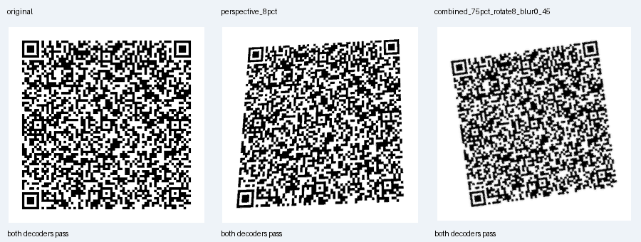

# 주차 메모 QR 교차 판독 검증

확인일: 2026-11-02 KST. 이 기록은 현재 QR 소스의 소프트웨어 판독 시험이다. 휴대폰 카메라나 실차 화면의 광학 검증이 아니다.

## 변경과 확인한 결과

메모 원문·저장 시각·휴대폰 복사본의 별도 수명을 유지하면서 QR 문구를 줄였다. 최대 한글 64자에서 UTF-8 본문은 351바이트에서 296바이트로 줄었다. QR의 오류 정정 M과 최소 4모듈 여백은 유지했다. 320px 코드에서 이 사례의 한 모듈은 3px에서 4px로 커졌다. 앱은 화면 여유에 따라 최대 400dp까지 QR을 표시한다.

현재 `ParkingMemoQr.kt`, `VisitCompanion.kt`, `VehicleGateway.kt`를 별도 JVM에서 직접 컴파일했다. 같은 Java ZXing 판독기로만 확인하던 시험에 OpenCV와 jsQR을 추가했다. 두 판독기에 문자 인코딩 힌트를 따로 제공하지 않았으며, 결과 문자열을 생성한 원문 전체와 비교했다.

| 확인 범위 | 이전 소스 | 현재 소스 |
| --- | ---: | ---: |
| 고정 시각·10종 메모·3크기의 원본 이미지, 2개 판독기 | 52/60 | 60/60 |
| 같은 이미지의 7가지 변환, 2개 판독기 | 331/420 | 380/420 |
| 비어 있지 않은 잘못된 문자열 반환 | 0 | 0 |
| 최소 4모듈 여백 | 30/30 | 30/30 |

분모는 이미지와 판독기의 조합 수다. 앱 기능 시험 수나 사용자 성공률로 더하거나 환산하지 않는다. 이전 결과는 게시된 `203841c`의 원본 소스를 별도로 컴파일해 재현했으며, 실패를 제거하지 않고 [이전 결과](completion-qr-before.json)에 보존했다. 현재의 전체 결과와 소스 해시는 [completion-qr.json](completion-qr.json)에 있다.

입력은 일반 주차 위치, 한글 64자, ASCII 64자, 이모지 32개, 기호 혼합, 결합 문자, 서로 다른 한글과 긴 위치 문장을 포함한다. Android와 HTML 입력 제한은 UTF-16 단위 64개다. 보조 평면 이모지 32개가 이 한도를 채운다. 웹 정책도 같은 기준으로 맞췄고, 33개 이모지와 65개 한글·ASCII를 거부하는 경계를 확인했다.

변환은 75% 축소, 12도 회전, 모서리 최대 8% 수준의 원근 변환, 회색 범위 45~180, 가우시안 블러 0.6, JPEG 품질 70, 축소·8도 회전·블러 0.45의 조합이다. 카메라 모델·반사·거리·움직임의 물리적 모사가 아니다. 아래 모음 이미지는 축소·양자화한 설명용 이미지이며, 판독 검사는 원래 변환 픽셀로 수행했다.



## 남은 판독기별 차이

고정 시각의 기본 60개 비교가 모두 통과해도 모든 내용과 시각의 호환성이 입증되지는 않는다. 별도로 저장 시각을 2026-11-02 08:00:00 KST와 2026-11-03 07:59:59 KST로 바꾼 20개 이미지에서는 38/40이 통과했다. `한`을 64번 반복한 코드만 OpenCV에서 결과를 얻지 못했고, jsQR은 원문 전체를 정확히 반환했다. 첫 시각을 400px로 검사한 10개 이미지도 19/20이었다. 빈 결과와 오독을 구분해 [호환성 추가 기록](completion-qr-compatibility.json)에 남겼다.

본문을 280바이트로 더 줄인 후보도 같은 입력으로 비교했다. 위의 두 시각에서는 40/40이었지만, 고정 시각의 확장 기본 집합이 56/60, 변환 집합이 360/420으로 악화돼 채택하지 않았다. 바이트 수 감소만으로 모든 QR 패턴의 호환성이 좋아진다고 판단하지 않았다.

OpenCV 4.12.0은 UTF-8 ECI에 관한 경고를 출력했다. 문자열을 실제로 얻은 경우에는 코드 포인트 전체를 비교했으며 jsQR과도 대조했다. 이 경고를 숨기거나 빈 판독 결과를 성공으로 계산하지 않았다.

## 최종 RC2 실제 화면 판독

최종 release SHA `779d69f7…`와 같은 main 소스를 사용하는 일반 AOSP debug UI 시험의 [표준 화면](android-aosp28-rc2-qr.png)과 [글자 1.3배 화면](android-aosp28-rc2-large-qr.png)을 사용했다. 중간 `424ec4` 후보 화면은 이 결과에 포함하지 않았다. 두 화면 모두 QR 전체·스캔 가이드·닫기 버튼이 보였다.

| 최종 캡처의 판독 범위 | OpenCV | jsQR | 합계 |
| --- | ---: | ---: | ---: |
| 변경하지 않은 전체 화면 2장 | 1/2 | 2/2 | 3/4 |
| 각각의 원본 400px QR 영역 | 1/2 | 2/2 | 3/4 |
| 같은 QR 영역 바깥에 흰 여백 40px를 더한 진단 | 2/2 | 2/2 | 4/4 |

표준 화면의 코드에서는 OpenCV가 문자열을 얻지 못했다. jsQR은 `B3 블루존 E12`, 저장 시각 `2026-11-02 11:19:16 KST`, 복사본 수명 안내를 모두 현재 소스 형식과 일치하게 반환했다. 글자 1.3배 화면의 `2026-11-02 11:25:02 KST` 코드는 두 판독기에서 모두 일치했다. 원본 전체 화면의 엄격 검사는 **종료 코드 1**이며 이 실패를 보존했다. 잘못된 비어 있지 않은 문자열을 반환한 경우는 없었다.

표준 화면에서도 QR 픽셀을 바꾸지 않고 바깥 흰 여백을 40px 더한 진단 이미지에서는 OpenCV 판독이 회복됐다. 이는 관측한 판독 과정의 여백·검출 민감성을 보여주는 별도 실험이다. 원래 앱 화면의 성공이나 물리적 카메라 성공으로 계산하지 않는다. 원본 해시·정확한 자르기 좌표·판독 문자열과 조건별 결과는 [최종 캡처 진단 JSON](completion-qr-capture-diagnostics.json)에 기록했다. [흰 여백을 더한 표준 코드](completion-qr-standard-padded-diagnostic.png)는 진단용으로 변환한 이미지다.

최종 APK별 설치·UI·캡처 근거는 [Android 런타임 기록](android-runtime.md)에서 확인한다. 화면의 저장 시각은 판독기 관측값이며 별도 시계 계측과의 일치를 주장하지 않는다. **물리적 휴대폰 스캔과 모든 판독기의 호환성은 미검증**이다.

## 재현

[검증 스크립트](../../scripts/verify-qr-handoff.py)는 외부 파일을 내려받거나 설치하지 않는다. JDK 17, Kotlin 2.0.21 컴파일러와 의존 JAR, ZXing core 3.5.4, Node, Python 환경을 준비한다. 이번 실행의 Python 패키지는 OpenCV 4.12.0, NumPy 2.2.6, Pillow 11.3.0이다.

별도 판독기로 사용한 [jsQR 1.4.0 파일](https://github.com/cozmo/jsQR/blob/8e6a036beafa7053dd44b1b76ac578d22b1b3311/dist/jsQR.js)은 Apache-2.0이며 앱에 포함하지 않는다. 스크립트는 파일 SHA-256 `3325b0888fa4745c4e6940897d8c4f426fbaae76901fcbfe1871a04e90a51655`를 요구한다. OpenCV 판독 API는 [공식 클래스 문서](https://docs.opencv.org/4.7.0/de/dc3/classcv_1_1QRCodeDetector.html)를 참고할 수 있다.

```bash
python scripts/verify-qr-handoff.py \
  --kotlin-lib /path/to/gradle-8.13/lib \
  --zxing-jar /path/to/core-3.5.4.jar \
  --jsqr /path/to/jsQR.js \
  --skip-screenshots \
  --output /tmp/arrival-qr-check
```

최종 실제 캡처를 함께 검사하려면 `--skip-screenshots`를 제거하고 `--screenshot docs/verification/android-aosp28-rc2-qr.png --screenshot docs/verification/android-aosp28-rc2-large-qr.png --require-current-screenshots`를 추가한다. 현재 소스의 본문 형식과 두 캡처의 판독 결과까지 일치해야 성공한다. 위 원본 화면 3/4 결과 때문에 이 엄격 실행의 종료 코드 1이 예상된다.

추가 시간 실험은 `--record-time 1793574000000 --sizes 320 --no-stress` 및 `--record-time 1793660399000 --sizes 320 --no-stress`로 재현한다. 보고된 미판독이 발생하면 종료 코드 1이 예상된다. 현재 앱 소스가 실행 도중 바뀌거나 고정한 판독기 파일이 다르면 스크립트도 중단한다.
