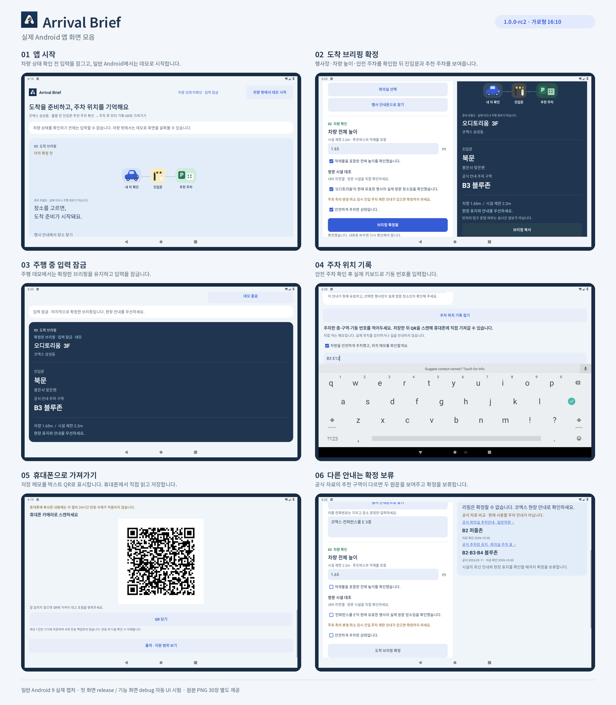

# Arrival Brief - 실제 Android 앱 스크린샷

버전: 1.0.0-rc2 / 정리일: 2026-11-02 KST

## 미리보기와 다운로드

- [전체 스크린샷 ZIP](ArrivalBrief-app-screenshots.zip)
- [대표 화면 8쪽 PDF](ArrivalBrief-app-screenshots.pdf)
- [대표 화면 PNG 8장](presentation/)
- [원본 PNG 30장](originals/)
- [원본 목록 CSV](screenshot-index.csv) · [출처와 SHA-256](manifest.json)

ZIP은 처음 배포한 스크린샷 패키지 그대로이며, 이 폴더의 README에는 GitHub에서 보기 편한 미리보기와 링크를 추가했습니다.

## 구성

- ArrivalBrief-app-screenshots-overview.png: 주요 흐름 6장을 한 장으로 정리
- ArrivalBrief-app-screenshots.pdf: 대표 8장을 한 페이지에 하나씩 수록
- presentation/: 제목과 가로형 기기 프레임을 붙인 대표 화면 8장
- originals/: 실제 앱 캡처 원본 PNG 30장, 원본 바이트 유지
- screenshot-index.csv / manifest.json: 원본 이름, 빌드 구분, 글자 크기, 해시와 출처

## 확인 범위

일반 Android 9 에뮬레이터의 실제 앱 화면입니다. 첫 실행과 설치된 아이콘은 release APK, 나머지는 같은 RC2 소스의 debug 자동 UI 시험 캡처입니다. 모두 가로 1280×800(16:10)이며, 화면 내용이나 상태를 합성·수정하지 않았습니다. 원본 외곽에만 제목·설명·기기 형태의 프레임을 배치했습니다. 웹 소개 화면이나 생성형 목업은 포함하지 않습니다.

실제 Pleos·실차 촬영 또는 실물 휴대폰 카메라 검증을 뜻하지 않습니다. 최종 QR 캡처의 독립 판독기 교차 검사는 3/4였고 OpenCV 미인식 1건이 기록되어 있습니다. 화면 모음의 축소 이미지 대신 originals/의 원본을 사용해 검토하세요.

원본 파일의 이름에 memo 또는 picker가 있어도 저장된 메모값이나 선택 대화상자가 모두 보이는 것은 아닙니다. 대표 주차 메모 화면에는 실제 키보드와 입력란이 보이는 ime 캡처를 선택했습니다.

출처: https://github.com/dbwls99706/arrival-brief/commit/b58b2a5b67cbf5498fc887f16fc58f37d44ed3ea
