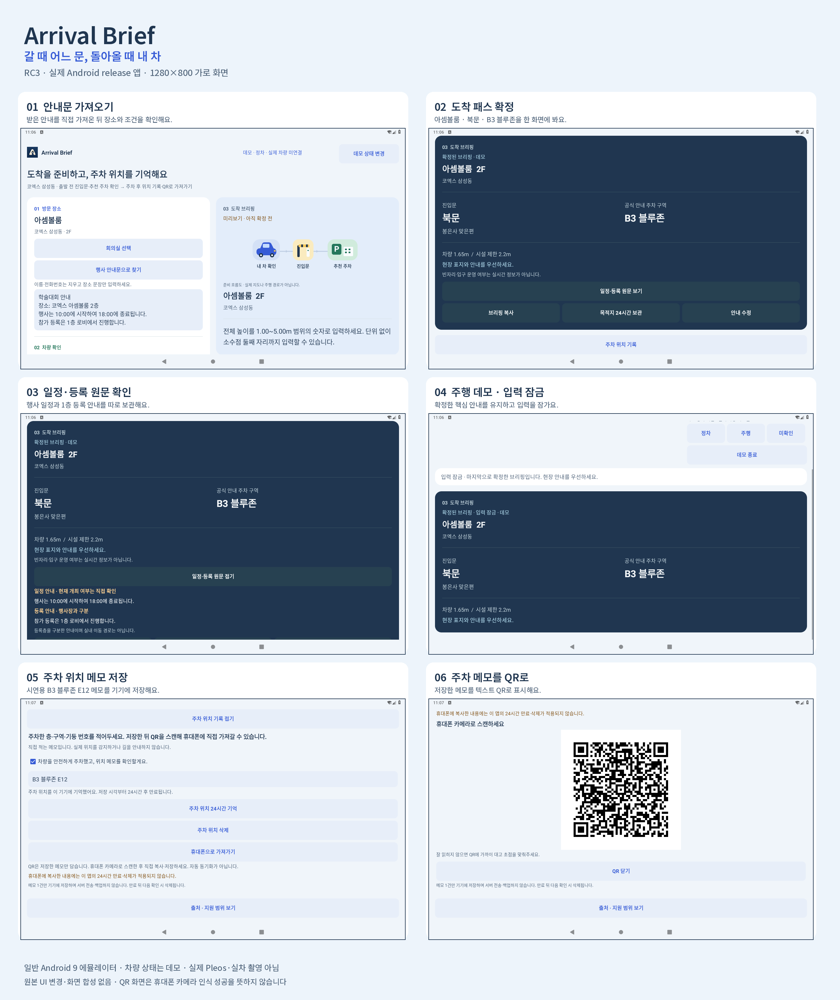

# Arrival Brief RC3 · 실제 release 앱 화면

`1.0.0-rc3` · versionCode 12 · 정리일 2026-11-02 KST

이전 버전의 실행 기록입니다. [현재 RC4 화면](../rc4/README.md)과 구분해 확인하세요.

행사 안내문을 가져와 도착 패스를 확정하고, 주차한 뒤 직접 적은 위치를 QR로 표시하는 실제 Android 앱 흐름입니다. 아래 6장은 모두 동일한 서명 **release APK**에서 얻었습니다.

## 원본 화면

| 순서 | 화면 | 확인할 내용 |
| --- | --- | --- |
| 1 | [안내문 가져오기](android-aosp28-rc3-release-scenario-notice-imported.png) | 아셈볼룸 2층, 행사 일정, 1층 등록 안내가 원문 그대로 들어옵니다. |
| 2 | [도착 패스 확정](android-aosp28-rc3-release-scenario-confirmed.png) | 확인한 차량 높이와 북문·B3 블루존을 집중 화면으로 표시합니다. |
| 3 | [일정·등록 원문 확인](android-aosp28-rc3-release-scenario-schedule-registration-notes.png) | 행사 일정과 등록 장소를 구분해 펼쳐 봅니다. 현재 개최 여부는 사용자가 확인합니다. |
| 4 | [주행 데모의 입력 잠금](android-aosp28-rc3-release-scenario-driving-locked.png) | 마지막으로 확정한 안내를 유지하며 입력을 잠급니다. |
| 5 | [주차 위치 저장](android-aosp28-rc3-release-scenario-memo-saved.png) | 사용자가 직접 적어 저장한 `B3 블루존 E12`가 보입니다. |
| 6 | [주차 메모 QR](android-aosp28-rc3-release-scenario-qr.png) | 저장 메모를 텍스트 QR로 표시합니다. 휴대폰에서 읽고 별도로 저장해야 합니다. |

## 출처와 확인 범위

일반 Android 9 AOSP 에뮬레이터의 가로 **1280×800**, 글자 크기 1.0배 화면입니다. 차량 상태는 앱의 데모이며 실제 Pleos 서비스·실차 촬영이 아닙니다. 공유받기는 같은 Android 기기 안의 텍스트 수신이며 휴대폰에서 차량으로 자동 전송한 장면이 아닙니다.

합성 행사 안내문과 시연용 주차 메모를 사용했습니다. 실제 행사 방문·주차 결과나 사용자 효과를 측정한 자료는 아닙니다.

원본 PNG는 바이트 그대로 복사했습니다. 모음 이미지도 각 원본의 1280×800 픽셀을 크기 변경 없이 배치하고 화면 밖에 제목과 프레임만 추가했습니다. UI 보정·자르기·서로 다른 상태의 화면 합성은 하지 않았습니다.

QR의 독립 판독기 검사는 RC3 표준·큰 글씨 debug 캡처에서 4/4, 이 release QR 캡처에서 1/2로 총 5/6입니다. 실물 휴대폰 카메라 검증은 아직 완료하지 않았습니다. 모음 이미지보다 위의 원본 PNG로 확인하세요.

- [원본 경로·파일별 SHA-256](manifest.json)
- [RC3 APK 고정본](https://github.com/dbwls99706/arrival-brief/blob/501e9e90a202d0b1ec133e5621450c805388c94a/apk/ArrivalBrief_release.apk) · [런타임 기록](../../docs/verification/android-runtime-rc3.json)
- [release 실행 영상](../../dist/assets/media/arrival-native-journey.mp4) · [영상 범위·프레임 검증 metadata](../../dist/assets/media/arrival-native-journey.json)
- [이전 RC2 화면 모음](../README.md#rc2-이전-기록)

영상은 하나의 화면 녹화에서 7개 상태를 확인한 자료입니다. 원본의 가변 프레임 시각과 실제 조작 경과 시간은 다르며 성능 측정 자료로 사용하지 않습니다. 최초 시간 대조 실패와 이후 장면·APK 일치 검증은 영상 metadata에 각각 보존했습니다.

Release APK SHA-256: `fbdfc4dda2ee7618876d2fc360ce7880d88ad1e95dc6e092fd245b05b411ed50`
