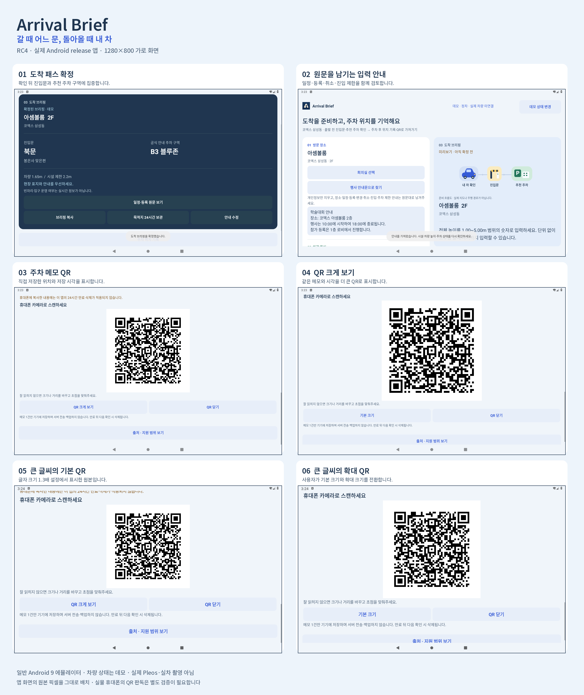

# Arrival Brief RC4 실제 앱 화면

동일한 서명 release APK를 일반 Android 9 에뮬레이터에서 실행한 가로 1280×800 원본 화면 6장입니다. 확정한 도착 패스와 입력 안내, 주차 메모 QR의 기본·확대 표시를 담았습니다.

[화면 6쪽 PDF](ArrivalBrief-app-screenshots.pdf) · [원본·설명 ZIP](ArrivalBrief-app-screenshots.zip) · [현재 APK](../../apk/ArrivalBrief_release.apk) · [버전·출처 기록](manifest.json)

| 순서 | 원본 화면 | 확인할 내용 |
| --- | --- | --- |
| 01 | [도착 패스 확정](01-confirmed.png) | 확인 뒤 진입문과 추천 주차 구역에 집중합니다. |
| 02 | [원문을 남기는 입력 안내](02-input-helper.png) | 일정·등록·취소·진입 제한을 함께 검토합니다. |
| 03 | [주차 메모 QR](03-qr-standard.png) | 직접 저장한 위치와 저장 시각을 표시합니다. |
| 04 | [QR 크게 보기](04-qr-expanded.png) | 같은 메모와 시각을 더 큰 QR로 표시합니다. |
| 05 | [큰 글씨의 기본 QR](05-large-font-qr.png) | 글자 크기 1.3배 설정에서 표시한 원본입니다. |
| 06 | [큰 글씨의 확대 QR](06-large-font-qr-expanded.png) | 사용자가 기본 크기와 확대 크기를 전환합니다. |

버전은 `1.0.0-rc4`이며 release APK SHA-256은 `865fb8368a81351575790fade68d5d27d805c1cfa8290897082fef056faa9da9`입니다. [실행 기록](../../docs/verification/android-runtime-rc4.json)과 각 캡처의 해시를 대조했습니다. 원본 PNG는 픽셀 수정·합성·자르기를 하지 않았고 모음 이미지의 바깥 제목과 프레임만 추가했습니다.

QR은 표준 화면에서 400→480픽셀, 글자 1.3배 화면에서 400→468픽셀로 전환됐습니다. [원본 8장·두 판독기 비교](../../docs/verification/completion-qr-rc4.json)는 16/16에서 저장 메모와 시각이 일치했습니다. 이는 소프트웨어 판독 결과이며 실물 휴대폰 카메라, 실제 Pleos·차량 검증을 뜻하지 않습니다.

[RC3 화면과 연속 시연](../rc3/README.md)은 이전 버전 기록입니다. 현재 RC4에서 연속 영상을 새로 촬영한 것으로 표시하지 않습니다.
